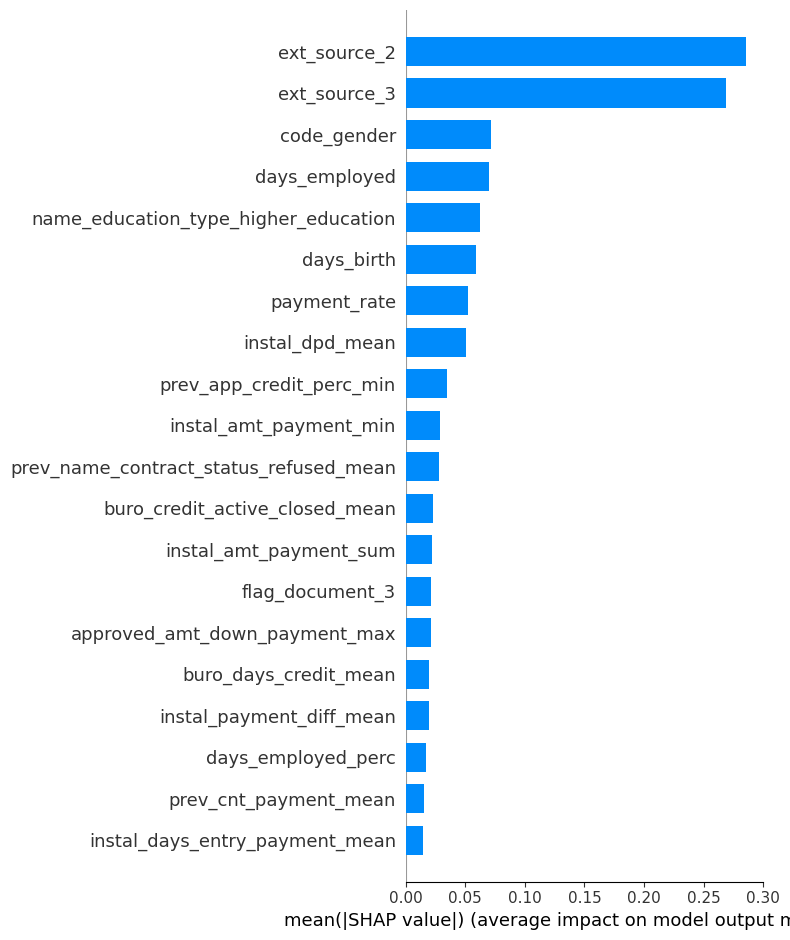
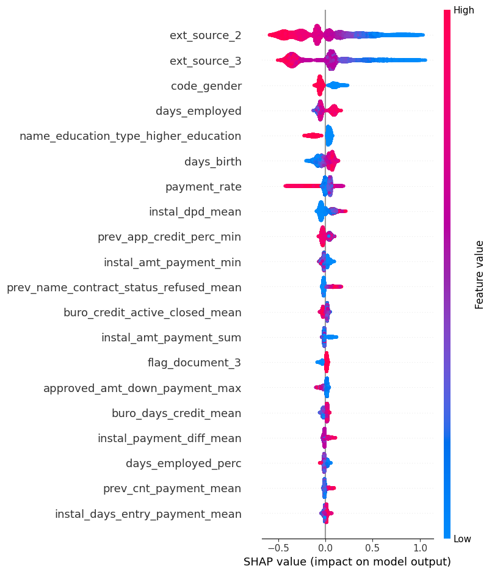
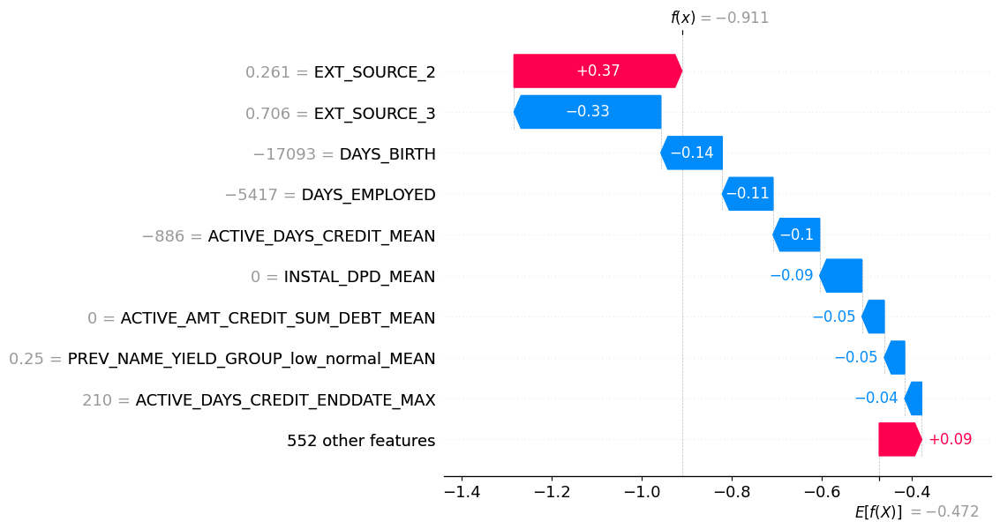

# Projet 06 - Modèle de scoring crédit

## Présentation

Ce projet développe un outil de **scoring crédit** capable d'estimer la probabilité
qu'un client ne rembourse pas son prêt (`TARGET = 1`), puis d'aider à classer une
demande comme acceptée ou refusée.

Le projet s'appuie sur le jeu de données [Home Credit Default Risk](https://www.kaggle.com/competitions/home-credit-default-risk)
et combine :

- les informations de la demande courante ;
- l'historique de crédit fourni par le bureau de crédit ;
- l'historique mensuel des crédits du bureau ;
- les demandes précédentes auprès de Home Credit ;
- les soldes POS-CASH ;
- les paiements d'échéances ;
- les soldes de cartes de crédit.

Le notebook principal est [`search.ipynb`](./search.ipynb). Il couvre l'exploration
des données, la préparation des variables, l'entraînement, l'évaluation,
l'optimisation du seuil de décision, le suivi MLflow et l'interprétabilité SHAP.

> **Important :** [`main.py`](./main.py) contient actuellement un exemple minimal
> et n'est pas le point d'entrée du pipeline décrit dans le notebook.

## Objectifs métier et machine learning

Le modèle doit :

1. produire une probabilité de défaut pour chaque client ;
2. transformer cette probabilité en décision selon un seuil configurable ;
3. privilégier la détection des défauts, car un faux négatif est plus coûteux
   qu'un faux positif ;
4. fournir une explication globale du modèle et une explication au niveau d'un
   client ;
5. permettre le suivi des expériences et la préparation d'un modèle exploitable
   en pré-production.

Le coût métier utilisé dans le notebook est :

```text
coût = 10 × FN + 1 × FP
```

Le seuil `0.5` n'est donc pas nécessairement le meilleur seuil de décision. Le
notebook recherche le seuil qui minimise ce coût sur un jeu de validation séparé.

## Données

Les fichiers sources attendus dans [`data/`](./data/) sont :

| Fichier | Contenu |
| --- | --- |
| `application_train.csv` | demandes d'apprentissage et cible `TARGET` |
| `application_test.csv` | demandes sans cible |
| `bureau.csv` | crédits provenant d'autres institutions |
| `bureau_balance.csv` | historique mensuel des crédits du bureau |
| `previous_application.csv` | anciennes demandes Home Credit |
| `POS_CASH_balance.csv` | historique des comptes POS-CASH |
| `installments_payments.csv` | paiements d'échéances |
| `credit_card_balance.csv` | historique des cartes de crédit |
| `HomeCredit_columns_description.csv` | description des variables |

Les fichiers `df_merged.csv` et `df_droped.csv` sont des artefacts générés par le
notebook :

- `df_merged.csv` contient les données jointes et agrégées ;
- `df_droped.csv` contient les variables dont le taux de valeurs manquantes est
  inférieur à 50 %, avec `SK_ID_CURR` retiré pour l'entraînement.

### Schéma des relations

```text
application_train / application_test
        |
        +-- bureau
        |     +-- bureau_balance
        |
        +-- previous_application
              +-- POS_CASH_balance
              +-- credit_card_balance
              +-- installments_payments
```

Les tables secondaires sont agrégées par `SK_ID_CURR` avant d'être jointes à la
table principale. Les identifiants techniques des tables secondaires ne sont pas
conservés dans les variables finales.

## Préparation des données

Le notebook réalise notamment les traitements suivants :

- encodage binaire des variables à deux modalités ;
- one-hot encoding des variables catégorielles ;
- remplacement des valeurs sentinelles `365243` par des valeurs manquantes ;
- création de ratios métier, par exemple :
  - `DAYS_EMPLOYED_PERC` ;
  - `INCOME_CREDIT_PERC` ;
  - `INCOME_PER_PERSON` ;
  - `ANNUITY_INCOME_PERC` ;
  - `PAYMENT_RATE` ;
- agrégation statistique (`min`, `max`, `mean`, `sum`, `var`, `size`) des
  historiques ;
- remplacement des infinis par `NaN` ;
- imputation médiane dans les pipelines où elle est utilisée ;
- nettoyage des noms de colonnes pour les modèles de gradient boosting ;
- séparation train/validation/test stratifiée.

Le premier assemblage produit **756 colonnes**. Après filtrage des colonnes ayant
moins de 50 % de valeurs manquantes et retrait de l'identifiant, le jeu utilisé
pour les expériences compte **565 variables**.

La cible est fortement déséquilibrée : le taux de défaut observé dans le jeu
d'apprentissage est d'environ **8,1 %**. Le notebook expérimente donc notamment
`class_weight`, `scale_pos_weight`, ENN et SMOTE.

## Modèles et expérimentation

Les modèles comparés dans le notebook sont :

- régression logistique ;
- Random Forest ;
- modèles de gradient boosting, notamment LightGBM/XGBoost selon les cellules
  d'expérimentation.

Les hyperparamètres sont recherchés avec **Optuna**. L'évaluation utilise une
validation croisée stratifiée et suit plusieurs indicateurs :

- ROC AUC ;
- précision ;
- rappel ;
- F1-score ;
- F-beta avec `beta=2` et `beta=5` ;
- coût métier `10 × FN + FP`.

### Résultats présents dans le notebook

Les valeurs ci-dessous sont les résultats enregistrés lors de l'exécution du
notebook, et non une garantie de résultat après une nouvelle exécution :

| Expérience | ROC AUC | Precision | Recall | F1 | Seuil |
| --- | ---: | ---: | ---: | ---: | ---: |
| Régression logistique, évaluation initiale | 0,5893 | 0,5096 | 0,5001 | 0,4795 | 0,5 |
| Modèle de gradient boosting, seuil optimisé | 0,7287 | 0,5570 | 0,6633 | 0,5486 | 0,56 |
| Régression logistique, autre configuration | 0,7779 | 0,7401 | 0,5157 | 0,5108 | 0,5 |

Les scores ne doivent pas être comparés sans tenir compte du modèle, du
prétraitement, du sous-échantillonnage et du découpage utilisés dans chaque
cellule. Le modèle retenu en pré-production doit être choisi à partir d'une
expérience MLflow reproductible et d'un compromis métier validé.

## Interprétabilité

Le notebook utilise **SHAP** pour répondre aux exigences de transparence :

- `shap.summary_plot(..., plot_type="bar")` : importance globale moyenne ;

- `shap.summary_plot(..., plot_type="dot")` : sens et amplitude de l'impact ;

- `shap.force_plot(...)` : explication d'un client donné ;
- `shap.plots.waterfall(...)` : détail des contributions positives et négatives
  pour une observation.


Une valeur SHAP positive augmente la sortie du modèle (risque de défaut) et une
valeur négative la diminue, sous réserve de l'espace de sortie du modèle et de
l'interprétation de l'explainer utilisé.

## MLOps et artefacts

Le suivi des expériences est réalisé avec **MLflow** :

- expérience : `Projet 06` ;
- optimisation des hyperparamètres avec Optuna ;
- journalisation des paramètres et métriques ;
- création de runs parent/enfants pour les essais ;
- journalisation des modèles scikit-learn et LightGBM ;
- persistance des artefacts dans [`mlruns/`](./mlruns/).

Le notebook peut utiliser un serveur MLflow PostgreSQL configuré par variables
d'environnement :

```text
DB_USER
DB_PASSWORD
DB_HOST
DB_PORT
DB_NAME
```

Ne jamais inscrire ces valeurs dans le dépôt. Un fichier `.env` local peut être
utilisé et doit rester ignoré par Git.

## Installation

Le projet utilise `uv` et demande Python `>=3.12, <=3.14`.

```powershell
uv sync
```

Les dépendances principales sont déclarées dans [`pyproject.toml`](./pyproject.toml) :
Pandas, scikit-learn, imbalanced-learn, LightGBM, XGBoost, Optuna, MLflow,
SHAP, Missingno et les outils Jupyter.

## Exécution du notebook

1. Ouvrir [`search.ipynb`](./search.ipynb) dans VS Code ou Jupyter.
2. Sélectionner l'environnement Python créé par `uv`.
3. Vérifier la présence des fichiers dans [`data/`](./data/).
4. Exécuter les cellules dans l'ordre.
5. Pour le suivi distant, renseigner les variables MLflow dans `.env` avant
   d'exécuter les cellules MLOps.

La préparation complète régénère notamment :

```text
data/df_merged.csv
data/df_droped.csv
```

Le notebook contient aussi des exécutions de contrôle et des graphiques de
valeurs manquantes, de corrélations, de matrices de confusion et de courbes
précision-rappel.

## Structure du dépôt

```text
.
├── data/                 # données sources et jeux agrégés
├── mlruns/               # artefacts et suivi MLflow local
├── main.py               # point d'entrée minimal (à compléter)
├── pyproject.toml        # dépendances et contraintes Python
├── search.ipynb          # exploration, modélisation et MLOps
├── uv.lock               # verrouillage des dépendances
└── README.md
```

## Limites et prochaines étapes

Avant une mise en production réelle, il reste notamment à :

- extraire le pipeline du notebook vers un module versionné et testable ;
- définir une seule expérience de référence et un protocole de validation fixe ;
- versionner les jeux de données et les features ;
- enregistrer le seuil métier avec le modèle dans le Model Registry ;
- ajouter des tests de données, de pipeline et de non-régression ;
- surveiller la dérive des données, la calibration des probabilités et les
  performances par segment ;
- documenter les règles de décision et les contrôles de biais ;
- servir le modèle via une API ou un batch de scoring sécurisé.
